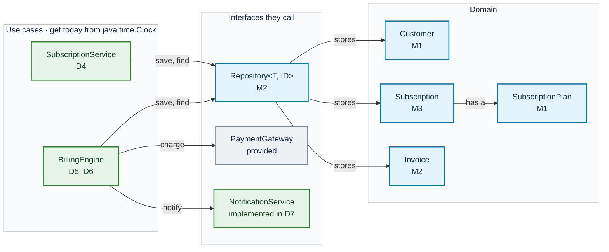
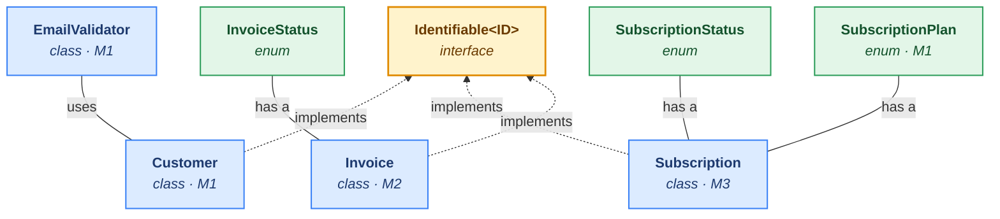
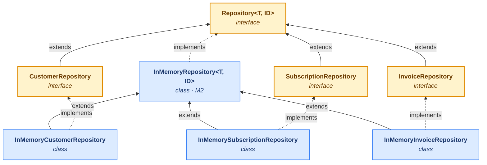
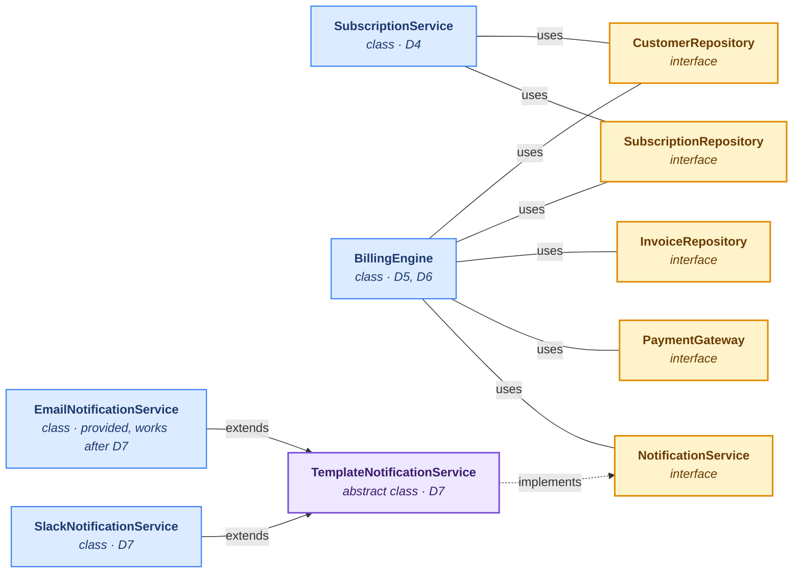

# SubStream — Campus Edition

**NIX Java Marathon challenge** · Java 17+, Maven, JUnit 5, RestAssured

> **Start here:** [`docs/GETTING_STARTED.md`](docs/GETTING_STARTED.md) for setup, then [`docs/SUBMISSION_RULES.md`](docs/SUBMISSION_RULES.md) before your first commit.

---

## 1. Overview

**SubStream** is the backend of a SaaS company that sells software subscriptions to businesses. It registers customers, manages their subscriptions, issues a monthly invoice for each subscription, and charges it through an external payment gateway.

Billing systems look simple and are full of traps: month-end dates, money, state rules, unreliable third-party services. That is exactly why companies care about engineers who can model them cleanly and test them well.

Everyone starts by building the core of the system (M1 – M3). Then you choose a track: on the Developer track you build the rest of SubStream; on the AQA Engineer track you test **SubStream Pricing**, a finished part of the system that is already in your project.

---

## 2. How the Challenge Works

### 2.1 Milestones

The challenge is a ladder of milestones that get harder as you climb. **Nobody is expected to finish all of them.** What counts is how far you get, how clean your work is, and whether you understand it.

| Milestone | Who | Topic | Your guide |
| :--- | :--- | :--- | :--- |
| **M0** | Everyone | Pre-flight, before the workshop, in your pre-flight project | The pre-flight project's `README.md` |
| **M1** | Everyone | Domain core: `SubscriptionPlan`, `EmailValidator`, `Customer` (started in the workshop) | `docs/SHARED_MILESTONES.md` |
| **M2** | Everyone | Invoices and generic storage | `docs/SHARED_MILESTONES.md` |
| **M3** | Everyone | Subscriptions: dates, plan changes, lifecycle | `docs/SHARED_MILESTONES.md` |
| **D4 – D7** | Developer track | Build the services, the billing engine and the reports, with a few tests of your own | `docs/TRACK_DEVELOPER.md` |
| **A4 – A7** | AQA Engineer track | Test your own classes, then SubStream Pricing: unit tests and API tests | `docs/TRACK_AQA.md` |

You do not need to read this whole README at once. Each guide gives every milestone a **checklist of its rules** in the order to work on them; this README holds the full text of each rule, with its tables and examples.

Rules of the ladder:

- Milestones are done **in order**, one branch and one Merge Request each (see `docs/SUBMISSION_RULES.md`).
- After M3 you choose **one** track by the branch you open next (`feature/d4-…` or `feature/a4-…`). The choice is final.
- **Stuck on one rule for more than an hour?** Merge what you have and move on. Each milestone is scored on its own, so a gap in one milestone does not cost points in the next. You can come back later with a new Merge Request from the same branch.

### 2.2 Levels

| Level | Reached when merged up to |
| :--- | :--- |
| 🥉 Bronze | M2 |
| 🥈 Silver | D4 or A4 |
| 🥇 Gold | D6 or A6 |
| 💎 Platinum | D7 or A7 |

### 2.3 How your work is evaluated

Every Merge Request is checked by an automated pipeline: it verifies the Git rules and compiles the project. A few minutes later a NIX bot runs the tests in an isolated environment and adds a comment: a **Structure** line (your milestone's structure test) and the rules of that milestone, each marked pass or fail. A failing rule never blocks the merge; a project that does not compile does. Before you merge, run the structure test of your milestone on your machine, for example `M1StructureTest` (`docs/SUBMISSION_RULES.md`, section 1).

The bot checks the basic cases of each rule. The final evaluation checks more cases of the same rules, so read each rule's examples carefully. After the deadline, NIX engineers review the results, the quality of your code and your Git history. NIX may invite some participants to a short technical discussion about their own solution.

**Your work must be your own:** you must be able to explain, and change, every line you submit.

---

## 3. Architecture

The diagrams of this section are drawn by GitLab: read them on your project's page in GitLab. IntelliJ's Markdown preview may show them as text only.



Colours: **blue** = everyone (M1 – M3) · **green** = Developer track (D4 – D7) · **grey** = provided.

**What each package is for.** In the workshop you work in `domain/` only; the other packages come in later milestones.

| Package | Its job | Why it is separate | You work in it |
| :--- | :--- | :--- | :--- |
| `domain` | The business objects (`Customer`, `Subscription`, `Invoice`, the plans) and the rules that protect their data | A rule lives with its data, so it holds wherever the object is used | M1 – M3 |
| `exception` | The errors SubStream raises, all under `SubStreamException` | Callers can catch one family and still know what went wrong | Provided |
| `repository` | Saving and finding objects | Storage can change (memory today, a database later) without touching a rule | M2 |
| `external` | The boundary to outside systems: the payment provider | Tests replace the real provider, so no test ever charges anyone | Provided |
| `service` | The use cases: subscribing, the billing run, reports, notifications | It coordinates the packages above and gets them through its constructor | D4 – D7 |
| `aqa/pricing` | SubStream Pricing, a separate finished system with its own REST API | It shares nothing with the rest, so the AQA track tests it on its own | A5 – A7 |

Dependencies point one way, towards `domain`: `service` uses the others, `repository` uses `domain`, and `domain` uses nothing outside itself but its exceptions.

All collaborators are passed through constructors (**constructor injection**). Business code never creates its own repositories, gateways or clocks with `new`. This is what makes the system testable.

**SubStream Pricing** (AQA track only) is a separate, finished module in `com.substream.aqa.pricing`, with its own REST API. It does not use the classes above. Its specification is `docs/aqa/PRICING_SPEC.md`.

### 3.1 How the classes relate

These diagrams show what the provided code already declares: which class implements which interface, and who uses whom. Your work is inside the classes.

| Colour or line | Meaning |
| :--- | :--- |
| 🟨 Yellow | Interface |
| 🟪 Purple | Abstract class |
| 🟦 Blue | Class |
| 🟩 Green | Enum |
| Solid arrow → | `extends` |
| Dotted arrow ⇢ | `implements` |
| Plain line, labelled | *has a* field of that type, or *uses* it |

**Domain (M1 – M3)**



**Storage (M2)**



**Services (Developer track)**



`EmailNotificationService` is provided, but it extends `TemplateNotificationService`, which you write in D7: until then, calling it throws `UnsupportedOperationException`. In D5 and D6 tests, pass a notification service of your own, a one-line lambda (`docs/primers/JUNIT5.md`).

---

## 4. Domain Model

**Encapsulation rules** (checked by the structure test of each milestone, for example `M1StructureTest`):

- All instance fields are `private` and have exactly the names in the tables below.
- Every field has a public getter `get<FieldName>()`, for example `failedPaymentAttempts` → `getFailedPaymentAttempts()`. Exceptions are named explicitly.
- **There are no setters.** State changes only through the business methods of each class.
- **A method that throws changes nothing:** the object keeps the values it had before the call.
- **Trimming** means removing whitespace at both ends: spaces, tabs and line breaks. Whitespace inside a value stays.

### 4.1 `Customer` (M1)

| Field | Type | Notes |
| :--- | :--- | :--- |
| `id` | `String` | |
| `name` | `String` | BR-101; stored trimmed (inner spaces stay: `"  Acme  Corp "` → `"Acme  Corp"`) |
| `email` | `String` | BR-102; stored trimmed and lower-case |
| `createdAt` | `LocalDate` | |

Public constant `MAX_NAME_LENGTH = 100` (provided). `Customer` is immutable: all fields are `final`.

### 4.2 `SubscriptionPlan` (enum, M1)

| Constant | `tier` (`int`) | `monthlyPrice` (`BigDecimal`) | `userLimit` (`int`) |
| :--- | :--- | :--- | :--- |
| `FREE` | 1 | `0.00` | 1 |
| `PRO` | 2 | `29.00` | 10 |
| `ENTERPRISE` | 3 | `199.00` | unlimited (`Integer.MAX_VALUE`) |

Methods: `getMonthlyPrice()`, `getUserLimit()`, `isUnlimited()`, `canAccommodate(int seats)` (true for 1 up to the user limit), `isUpgradeFrom(SubscriptionPlan other)` (compares `tier`, **never** `ordinal()`).

**Exception to the getter rule:** `tier` has **no** getter. It is an internal detail of `isUpgradeFrom()`.

### 4.3 `SubscriptionStatus` (enum, provided)

`ACTIVE`, `SUSPENDED`, `CANCELLED`

### 4.4 `Subscription` (M3)

| Field | Type | Notes |
| :--- | :--- | :--- |
| `id` | `String` | |
| `customerId` | `String` | |
| `plan` | `SubscriptionPlan` | Can change (BR-104) |
| `status` | `SubscriptionStatus` | Starts as `ACTIVE` |
| `seatCount` | `int` | BR-103 |
| `startDate` | `LocalDate` | Anchor of every renewal date |
| `billingCycle` | `int` | Number of paid cycles; starts at 0 |
| `failedPaymentAttempts` | `int` | Consecutive failures; starts at 0 |

**Exception to the getter rule:** `getRenewalDate()` has **no field**. It is calculated on every call (BR-201).

The constructor refuses `null` for `id`, `customerId`, `plan` and `startDate` with a `NullPointerException`.

### 4.5 `InvoiceStatus` (enum, provided)

`UNPAID`, `PAID`

### 4.6 `Invoice` (M2)

| Field | Type | Notes |
| :--- | :--- | :--- |
| `id` | `String` | |
| `subscriptionId` | `String` | |
| `periodStart` | `LocalDate` | The renewal date being billed |
| `amount` | `BigDecimal` | Always scale 2; a negative amount → `IllegalArgumentException` |
| `issueDate` | `LocalDate` | |
| `dueDate` | `LocalDate` | |
| `status` | `InvoiceStatus` | Starts as `UNPAID` |

The constructor stores the values it is given. Which values a renewal uses (BR-302: amount = the plan's monthly price, and so on) is the billing engine's job in D5, not the `Invoice`'s.

`markPaid()` changes `UNPAID` to `PAID`; paying an invoice twice throws `IllegalStateException`. `isOverdue(today)` follows BR-602.

### 4.7 Equality

`Customer`, `Subscription` and `Invoice` implement `equals()` and `hashCode()` based on `id` only. You write them for `Customer` in M1; `Invoice` and `Subscription` come with the same two methods already provided.

### 4.8 Exceptions (provided)

```
SubStreamException (extends RuntimeException)       <- unchecked base
 ├── InvalidCustomerDataException
 ├── InvalidPlanTransitionException
 ├── InvalidStatusTransitionException
 ├── SubscriptionNotFoundException
 └── CustomerNotFoundException

PaymentGatewayTimeoutException (extends Exception)  <- checked, declared by PaymentGateway
```

---

## 5. Business Rules

The rules are grouped by business area, the way a real specification is written. Each rule has a fixed ID: the bot's comment, the milestone checklists and the defect notes all refer to it. To find which milestone needs a rule:

| Milestone | Rules |
| :--- | :--- |
| M1 | BR-101, BR-102 (and section 4.2) |
| M2 | BR-602 `isOverdue` (and sections 4.6, 6) |
| M3 | BR-103, BR-201, BR-301, BR-104, BR-305 – BR-307 inside `Subscription`, BR-401 |
| D4 | BR-202, BR-501 – BR-503 |
| D5 | BR-301, BR-302, BR-304, BR-305, BR-309 in the billing engine |
| D6 | BR-306, BR-303, BR-307, BR-308 in the billing engine |
| D7 | BR-601 – BR-603 |
| A4 | The M1 and M3 rules, tested |
| A5 – A7 | PR-1 – PR-6 and the API of SubStream Pricing, in `docs/aqa/PRICING_SPEC.md` |

**Some rules are built in two parts, in two milestones.** BR-301 and BR-305 – BR-307: in M3, `Subscription` only changes its own fields (`isDue`, the cycle, the failure counter, the status); in D5 and D6 the billing engine does the rest (the invoice, the gateway, the notification). Each rule below says which part is where, and each milestone's checklist lists only its own part.

### Module A — Customers & Plans

* **BR-101:** `name` must be non-blank after trimming and at most 100 characters after trimming. `null` is invalid. Otherwise `InvalidCustomerDataException`.
* **BR-102:** `email` is valid only if **all** of these hold after trimming:
  1. It contains no whitespace (no space, tab or line break).
  2. It contains exactly one `@`, with at least one character before it.
  3. The part after `@` contains at least one `.`.

  Nothing else is checked: upper case letters and any other characters (`.`, `-`, `_`, `+`) are allowed. `null` is invalid. An invalid email in the `Customer` constructor → `InvalidCustomerDataException`.
* **BR-103:** A new subscription needs `plan.canAccommodate(seatCount)`. Otherwise `IllegalArgumentException`.
* **BR-104 (Plan change):** takes effect immediately.

  | Current status | Change | Condition | Result |
  | :--- | :--- | :--- | :--- |
  | Not `ACTIVE` | Any | — | `InvalidPlanTransitionException` |
  | `ACTIVE` | Same plan | — | `InvalidPlanTransitionException` |
  | `ACTIVE` | Upgrade | — | Allowed |
  | `ACTIVE` | Downgrade | `seatCount <= target.userLimit` | Allowed |
  | `ACTIVE` | Downgrade | `seatCount > target.userLimit` | `InvalidPlanTransitionException` |

  Examples: `ENTERPRISE → PRO` with 10 seats is allowed, with 11 seats rejected.

---

### Module B — Dates

* **BR-201 (Anchored renewal):** `renewalDate = startDate.plusMonths(billingCycle + 1)`. Adding one month to the previous renewal date is **wrong**: it drifts at month ends.

  | `startDate` | Cycle 0 | Cycle 1 | Cycle 2 |
  | :--- | :--- | :--- | :--- |
  | 2024-01-15 | 2024-02-15 | 2024-03-15 | 2024-04-15 |
  | 2024-01-31 | 2024-02-29 | 2024-03-31 | 2024-04-30 |
  | 2023-01-31 | 2023-02-28 | 2023-03-31 | 2023-04-30 |

* **BR-202 (Injected clock):** services get "today" as `LocalDate.now(clock)` from the injected `java.time.Clock`. Plain `LocalDate.now()` is forbidden.

---

### Module C — Billing

* **BR-301 (Due):** a subscription is due when `status == ACTIVE` **and** `renewalDate <= today`: its renewal date is today, **or an earlier date** that is not paid yet (after a failed payment the renewal date does not move, so the subscription stays due). `isDue(today)` in `Subscription` (M3); the billing engine bills only due subscriptions (D5).
* **BR-302 (Invoice):** `periodStart = renewalDate`, `amount = plan.monthlyPrice` (whatever the seat count), `issueDate = today`, `dueDate = today + config.invoiceDueDays`, `status = UNPAID`. The gateway is charged with the customer's id and this amount.
* **BR-303 (One invoice per period):** at most one invoice exists per `(subscriptionId, periodStart)`. A retry **reuses** the existing `UNPAID` invoice. Each attempt saves the invoice exactly once, after the payment outcome is known.
* **BR-304 (FREE plan):** the gateway is **never called** for `FREE`. The `0.00` invoice is marked `PAID` and the subscription renews.
* **BR-305 (Success):** invoice → `PAID`; `billingCycle + 1`; `failedPaymentAttempts → 0`; the status stays `ACTIVE`. In `Subscription.recordPaymentSuccess()` (M3): the cycle and the counter only. In the billing engine (D5): the invoice.
* **BR-306 (Failure):** `PaymentResult.failed(...)`, a `PaymentGatewayTimeoutException`, or any `RuntimeException` from the gateway. The invoice stays `UNPAID`, `failedPaymentAttempts + 1`, the renewal date does not move. A run charges each due subscription **at most once**; the next attempt is the next run. In `Subscription.recordPaymentFailure(max)` (M3): the counter. In the billing engine (D6): catching the gateway's errors and keeping the invoice.
* **BR-307 (Suspension):** when `failedPaymentAttempts` reaches `config.maxFailedAttempts` (3 by default): status → `SUSPENDED`, and `NotificationService.notifySuspension(customer, subscription)` is called **exactly once**. In `Subscription.recordPaymentFailure(max)` (M3): the status, and the method returns `true`. In the billing engine (D6): the notification, when that method returns `true`.

  | Consecutive failures | Status | Notification |
  | :--- | :--- | :--- |
  | 1 | `ACTIVE` | No |
  | 2 | `ACTIVE` | No |
  | 3 | `SUSPENDED` | Yes, once |
  | 2, then a success | `ACTIVE`, counter 0 | No |

* **BR-308 (Batch robustness):** an unexpected `RuntimeException` while processing one subscription counts as `failed` in the summary. The run **continues** with the other subscriptions. Examples: the customer of a due subscription is missing (throw `CustomerNotFoundException`), or the notification service throws.
* **BR-309 (Summary):** `runRenewals()` returns `BillingRunSummary(eligible, succeeded, failed, suspended)`, where `eligible` is the number of due subscriptions and the other three add up to it. Each due subscription counts once:

  | Outcome of the subscription in this run | Counted as |
  | :--- | :--- |
  | Paid (`FREE` included) | `succeeded` |
  | A failure that suspends it (BR-307) | `suspended` |
  | Any other failure: declined, timeout, gateway error, or an unexpected error such as a missing customer or a failing notification (BR-308) | `failed` |

---

### Module D — Lifecycle

| From \ Action | `cancel()` | Payment success or failure |
| :--- | :--- | :--- |
| **`ACTIVE`** | → `CANCELLED` | Allowed (BR-305 – BR-307) |
| **`SUSPENDED`** | → `CANCELLED` | ❌ |
| **`CANCELLED`** | ❌ | ❌ |

* **BR-401:** every ❌ throws `InvalidStatusTransitionException`. `CANCELLED` is final.

---

### Module E — Services

The rules of the domain classes still apply inside the services: when a domain class throws (BR-101 – BR-104, BR-401), the exception reaches the caller and nothing is saved. Every method changes only the customer or subscription it is given.

* **BR-501:** `registerCustomer(name, email)` creates a customer with a new random UUID as its id (the standard 36-character form, for example `3f2b8c1e-9a4d-4e7b-8c2f-1d5e6a7b8c9d`) and `createdAt = today`, saves and returns it.
* **BR-502:** `subscribe(customerId, plan, seatCount)` throws `CustomerNotFoundException` for an unknown customer and saves **nothing**. Otherwise it creates an `ACTIVE` subscription with a new random UUID as its id and `startDate = today`, saves and returns it. A customer can have several subscriptions.
* **BR-503:** `changePlan(...)` and `cancel(...)` throw `SubscriptionNotFoundException` for an unknown id, and change nothing. Otherwise they apply the change, save and return the subscription.

---

### Module F — Reporting & Notifications

* **BR-601 (MRR):** monthly recurring revenue = sum of `monthlyPrice` of **`ACTIVE`** subscriptions, one price per subscription whatever its seat count, scale 2. Empty input, or no `ACTIVE` subscription → `0.00`.
  Example: 2 × `PRO` active, 1 × `ENTERPRISE` active, 1 × `FREE` active, 1 × `PRO` suspended, 1 × `ENTERPRISE` cancelled → **257.00**.
* **BR-602 (Overdue):** an invoice is overdue if it is `UNPAID` and `dueDate < today`. `findOverdue(invoices, today)` returns the overdue invoices sorted by `dueDate`, oldest first, and an empty list when none is overdue.
* **BR-603 (Notifications):** `TemplateNotificationService` builds the message:

  `Dear <name>, your <plan> subscription <id> has been suspended after <n> failed payment attempt(s). Please update your payment method.`

  where `<name>` is the customer's name, `<plan>` the subscription's plan, `<id>` the subscription's id and `<n>` its `failedPaymentAttempts`. It stores `format(resolveRecipient(customer), message)`. `getSentMessages()` returns all lines stored by **this** service object, oldest first, as a list that cannot be modified (empty for a new service).

  | Subclass | Recipient | Stored line |
  | :--- | :--- | :--- |
  | `EmailNotificationService` | the customer's email | `EMAIL to <recipient>: <message>` |
  | `SlackNotificationService(channel)` | the channel, e.g. `#billing` | `SLACK <recipient>: <message>` |

  The Slack channel is used exactly as given: it must start with `#` followed by at least one character, otherwise `IllegalArgumentException` (`""`, `"#"`, `"billing"` and `" #billing"` are all refused).

---

## 6. Provided Infrastructure

| Type | What it is |
| :--- | :--- |
| `Repository<T, ID>` and its three sub-interfaces | Storage contracts: `save`, `findById` (returns `Optional`), `findAll`, `count`. `InvoiceRepository` adds `findByKey(subscriptionId, periodStart)` |
| `InMemoryCustomerRepository`, `InMemorySubscriptionRepository`, `InMemoryInvoiceRepository` (with `findByKey`) | Ready once your generic `InMemoryRepository` works (M2). `save` stores the entity under its id and returns it; saving an existing id replaces the stored entity, which keeps its place in the order. `findById` of an unknown id is an empty `Optional`. `findAll()` returns entities in insertion order, as a list the caller cannot change. Each repository object has its own content |
| `PaymentGateway`, `PaymentResult` | The external payment provider. Never implement it in production code; tests replace it |
| `BillingConfig` | `maxFailedAttempts` and `invoiceDueDays`; `BillingConfig.defaults()` gives 3 and 14 |
| `BillingRunSummary` | Result record of `runRenewals()` |
| `NotificationService` | Interface used by `BillingEngine` |

---

## 7. Project Structure

`[P]` = provided, do not change · `[M1]`, `[M2]`, `[D4]` … = skeleton you complete in that milestone.

**Which files are yours after M3:** `service/` is for the **Developer track only**; everything under `aqa/` and `docs/aqa/` is for the **AQA track only**. Each of those files says so at the top of the file or in its path. Ignore the other track's files.

```text
substream-campus/
├── pom.xml                                   [P]
├── .gitlab-ci.yml                            [P]
├── README.md                                 this specification
├── REFLECTION.md                             you fill it in before the deadline
├── docs/                                     guides and rules
│   └── aqa/                                  AQA TRACK ONLY: pricing spec and RestAssured primer
└── src
    ├── main/java/com/substream
    │   ├── domain
    │   │   ├── Identifiable, SubscriptionStatus, InvoiceStatus     [P]
    │   │   ├── SubscriptionPlan, EmailValidator, Customer          [M1]
    │   │   ├── Subscription                                        [M3]
    │   │   └── Invoice                                             [M2]
    │   ├── exception                                               [P]
    │   ├── external      PaymentGateway, PaymentResult             [P]
    │   ├── repository
    │   │   ├── interfaces, InMemoryCustomer/Subscription/InvoiceRepository [P]
    │   │   └── InMemoryRepository                                  [M2]
    │   ├── service                                                 DEVELOPER TRACK ONLY
    │   │   ├── BillingConfig, BillingRunSummary, NotificationService [P]
    │   │   ├── EmailNotificationService                            [P] example
    │   │   ├── SubscriptionService                                 [D4]
    │   │   ├── BillingEngine                                       [D5, D6]
    │   │   └── BillingMetrics, Template/SlackNotificationService   [D7]
    │   └── aqa/pricing                                             AQA TRACK ONLY [P]
    │       ├── PricingService and its records and exceptions       the system you test
    │       └── api/PricingApi                                      its REST API
    └── test/java/com/substream
        ├── structure/M1StructureTest … M3StructureTest             [P] run when you finish that milestone
        ├── structure/ServicesStructureTest                         [P] Developer track
        ├── structure/StructureCheck                                [P] helper of the structure tests
        ├── domain/SubscriptionPlanTest                             [P] example test
        ├── aqa/pricing/PricingServiceExampleTest                   AQA TRACK ONLY [P] example test
        ├── aqa/pricing/api/CouponApiExampleTest                    AQA TRACK ONLY [P] example test
        └── your own tests, in the package of the class they test
```

---

## 8. What Good Code Looks Like Here

These points are part of the evaluation, for everyone:

- **Encapsulation:** private fields, no setters, validation in the constructor, `final` wherever a value never changes.
- **Names that explain:** `isDue(today)` reads better than `check(d)`. No abbreviations, no magic numbers (use `BillingConfig`).
- **Small methods:** if a method needs a comment to explain its parts, split it into private methods named after those parts.
- **Money:** always `BigDecimal`; compare amounts with `compareTo`, never `equals`.
- **No `System.out`** in production code.
- **Do not change** provided files, public signatures or field names: other code and the automated checks depend on them.
